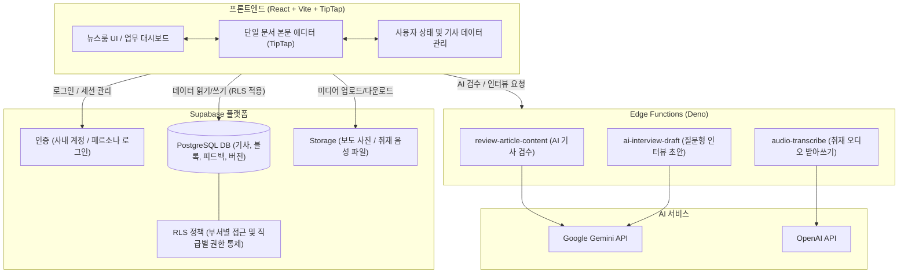
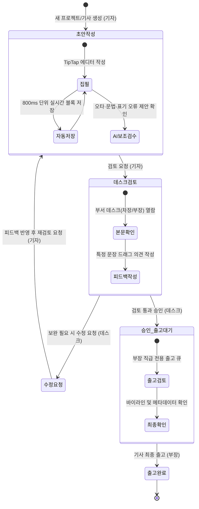

# PRESS-CMS

> 기자가 기사를 쓰고, 데스크가 검토하고, 부장이 출고하는 과정을 한 곳에서 하는 사내 기사 작성 프로그램

- **배포 사이트**: [https://a-team-press-cms.onrender.com](https://a-team-press-cms.onrender.com)

---

## 📷 시스템 화면


*(메인 화면 스크린샷 이미지 위치: `docs/images/main.png`)*

---

## 📁 폴더 구조

```text
PRESS-CMS/
├── .vscode/               # 에디터 작업 환경 설정
├── docs/                  # 프로젝트 문서 및 시험 자료
│   ├── deliverables/      # 최종 산출물 (요구사항분석표, 통합현황표 엑셀/마크다운)
│   ├── dev-log/           # 주간 개발 기록 및 개발 일지 색인(INDEX)
│   ├── guides/            # 기사 작성 표기 가이드 및 사내 부서별 권한 정책
│   ├── images/            # README 및 문서용 이미지 저장소
│   ├── internal/          # 내부 기획 및 개발 작업 메모 (.gitignore 제외 대상)
│   └── test-data/         # AI 검수 및 음성 인터뷰 시험용 샘플 데이터 (오디오/TXT/CSV)
├── public/                # 파비콘, 배경 이미지 등 정적 웹 자원
├── src/                   # React 프론트엔드 애플리케이션 소스 코드
│   ├── components/        # 에디터, 업무 대시보드, 미디어 라이브러리 등 화면 UI 컴포넌트
│   ├── lib/               # Supabase 클라이언트 설정 및 공통 유틸리티
│   ├── services/          # Supabase DB 연동 및 비즈니스 로직 서비스 계층
│   └── types/             # 기사, 권한, 프로필 등 TypeScript 공통 인터페이스
├── supabase/              # 백엔드 BaaS (인증, 데이터베이스, 서버리스 함수)
│   ├── functions/         # Supabase Edge Functions (AI 검수, 인터뷰 초안, 음성 받아쓰기)
│   └── migrations/        # PostgreSQL 스키마, 함수, RLS 보안 정책 마이그레이션 파일
├── .env.example           # 환경 변수 설정 예시 파일
├── .gitignore             # Git 추적 제외 규칙
├── index.html             # 웹 애플리케이션 진입 HTML
├── package.json           # 프로젝트 의존성 및 실행 스크립트 정의
├── tsconfig.json          # TypeScript 컴파일러 설정
└── vite.config.ts         # Vite 빌드 및 개발 서버 설정
```

---

## 🏛️ 프로그램 구조

PRESS-CMS는 **React SPA 프론트엔드**와 **Supabase(PostgreSQL + RLS + Edge Functions)** 백엔드로 동작합니다.  
AI 기능은 클라이언트에 API 키를 노출하지 않고, Supabase Edge Functions 서버리스 환경을 통해 호출됩니다.



---

## 🔄 기사 워크플로우

기사의 라이프사이클은 **작성(기자) → 검토(데스크) → 승인 및 출고(부장)** 단계로 엄격하게 통제됩니다.  
모든 승인 및 피드백은 같은 부서 소속 여부와 직급 권한(RLS)을 확인합니다.



---

## 🚀 시작하기

### 1. 사전 요구사항
- Node.js 18 이상 권장
- npm 또는 yarn

### 2. 설치 및 환경 변수 설정

저장소를 복제한 뒤 의존성 패키지를 설치합니다:

```bash
npm install
```

루트에 `.env.example` 파일을 복사하여 `.env.local` 파일을 생성하고 Supabase 연결 정보를 입력합니다:

```bash
# Windows PowerShell
Copy-Item .env.example .env.local

# macOS / Linux
cp .env.example .env.local
```

`.env.local` 내용 예시:
```env
VITE_SUPABASE_URL=https://your-project-id.supabase.co
VITE_SUPABASE_ANON_KEY=your-anon-key-here
```

> [!CAUTION]
> 보안을 위해 `.env.local` 파일은 절대 Git 저장소에 커밋하거나 외부에 공유하지 마십시오.

### 3. 로컬 개발 서버 실행

```bash
npm run dev
```

브라우저에서 `http://localhost:5173`으로 접속합니다.

### 4. 프로덕션 빌드 및 검사

```bash
npm run build
```

빌드 산출물은 `dist/` 폴더에 생성됩니다.

---

## ☁️ Supabase 서버 기능 배포

### 1. Supabase CLI 연결
```bash
npx supabase login
npx supabase link --project-ref <YOUR_SUPABASE_PROJECT_ID>
```

### 2. 데이터베이스 마이그레이션 적용
`supabase/migrations/` 폴더의 스키마 변경 사항을 원격 데이터베이스에 반영합니다:
```bash
npx supabase db push
```

### 3. Edge Functions 배포
AI 검수 및 오디오 처리 서버리스 함수를 배포합니다:
```bash
# AI 기사 검수 함수 배포
npx supabase functions deploy review-article-content

# AI 인터뷰 초안 함수 배포
npx supabase functions deploy ai-interview-draft

# 취재 오디오 받아쓰기 함수 배포
npx supabase functions deploy audio-transcribe
```

서버 기능 동작에 필요한 API Key(Gemini, OpenAI 등)는 Supabase 대시보드의 **Settings > Vault** 또는 **Secrets CLI**(`npx supabase secrets set`)를 통해 안전하게 등록합니다.
